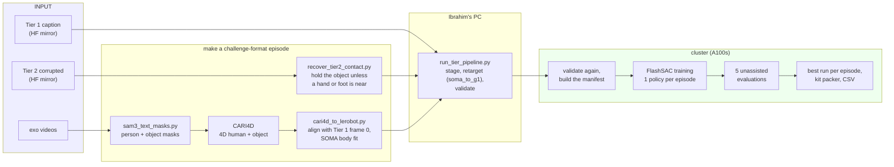
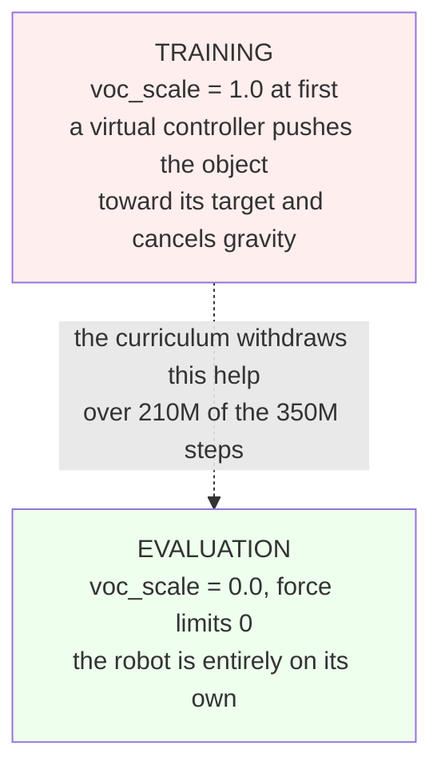
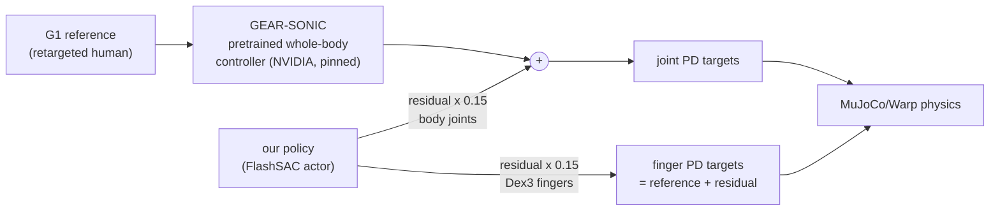
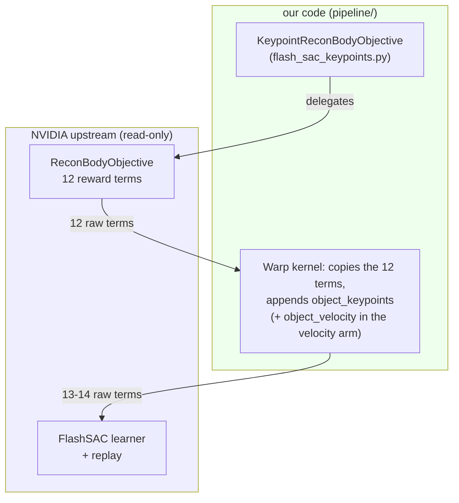
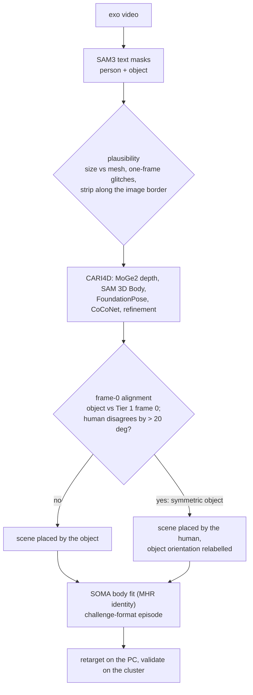
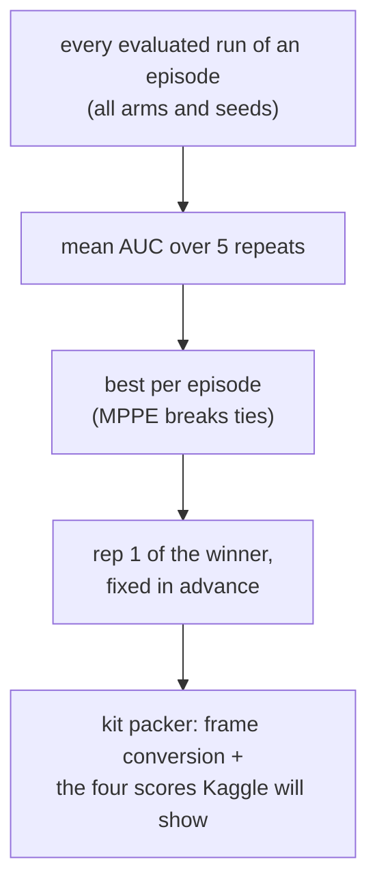

# How this project works

Plain-English explanation of what we built, why it is shaped this way, and how data moves
through it. Commands live in the [README](../../README.md); measured results and traps live in
[CLAUDE.md](../../CLAUDE.md); what each file does is in [CODE_MAP.md](CODE_MAP.md).

---

## 1. The problem, in one paragraph

NVIDIA filmed people doing everyday manipulation: tipping up a bar stool, sweeping with a
squeegee, turning a rice cooker. Each of the 30 episodes is a **reference trajectory**, giving where
the object was and how the person moved, frame by frame. A simulated Unitree G1 humanoid with Dex3
hands has to reproduce **the object's motion**, on its own, and we submit what the object
actually did. **We are scored on the object, not the robot.**

Scoring is four metrics per tier: AUC (fraction of frames with object points within 1-9 cm,
dominated by orientation), SP-SR and MP-SR (success rates), and MPPE (keypoint error in cm). The
final rank is the lowest **sum of per-metric ranks**. The three tiers count equally, and a team
missing a tier is unranked.

| Tier | What we get | What it tests |
|---|---|---|
| 1 | the clean multi-view caption | control |
| 2 | the same, with a corrupted object track (random walk up to 30 deg / 3 cm) | robustness to bad input |
| 3 | nothing: we reconstruct each episode from its monocular exo video | the whole video-to-robot chain |

## 2. The pipeline

Every tier ends in the same retarget, train, evaluate, pack chain. The tiers differ only in
how the input is produced.

**Retarget.** A human body is not a G1 body. NVIDIA's `soma_to_g1.py` solves the robot joint
angles per frame. We only wrap it: `retarget_episode_g1.py` chunks the body-model evaluation,
because the original runs out of memory on 8 GB. It runs in `robotic-grounding:latest`, which
exists only on Ibrahim's PC, so every reference is built there and rsynced to the cluster.

**Validate.** Before any GPU time, 45 checks: joint speeds inside the URDF limits, retarget
residual comparable to NVIDIA's own demo, no teleports, the robot grounded, hands reaching the
object. They run on the PC and again on the cluster, on the exact files training will read.

**Train.** One FlashSAC policy per episode with NVIDIA's `g1_recon_body_flash_sac` recipe:
350M environment steps at 2,048 worlds, about 3 h on an A100. Our changes are reward terms and
hyper-parameters (section 5), never upstream code.

**Evaluate and pack.** NVIDIA's unchanged evaluator runs each policy unassisted, in one world,
five times. The best run per episode (by mean AUC) goes to the kit's packer, which converts the
object trajectory into the released world frame and prints the same scores Kaggle reports.

## 3. The rule that matters most: training helps, evaluation does not

Early training gets an invisible helper on the object. Evaluation gets none. A replay that looks
perfect in training can be worthless, and training's own tracking errors overstate quality
because episodes terminate at 10 cm. Only the unassisted evaluation counts.

## 4. The control stack: who moves the robot

- The **walking and balance** come from GEAR-SONIC, NVIDIA's pretrained controller. Pretrained
  controllers are allowed (FAQ), and whole-body control is required.
- Our policy adds a **residual** on top. This residual is what makes the pelvis and torso
  shake: the smooth arm penalises it, and the gentle arm halves it.
- The **fingers have no prior**: `soma_to_g1` leaves them open, and the human data barely moves
  them. The scripted-grip references close them during contact so the policy does not have to
  discover grasping alone.
- The **big strides** come from the fixed playback rate: one 30 fps dataset frame per 50 Hz
  control step, 1.67x real time, the same for every team because the packer needs one row per
  frame.

## 5. How we extend NVIDIA's code without touching it

`official/` is NVIDIA's code at commit `193382a`, and we never edit it. New reward terms are
added by **wrapping**:

- FlashSAC sizes everything from `len(objective.term_names)`, so extra terms need no upstream
  change. Terms are stored **raw** and re-weighted at sample time, so a term must be a real
  column, not a patch to the scalar reward.
- NVIDIA's evaluator rebuilds the experiment from config baked into the checkpoint, and that
  config names our module. `flash_sac_actor_export.py` writes a **portable** copy with the stock
  config and byte-identical weights, and the evaluator runs that copy.
- Upstream bugs in CARI4D are handled the same way: the sbatch patches a *copy* of the one file
  and bind-mounts it read-only over the image's version.

The objective arms (all selectable with `ARM=`):

| Arm | Adds | Why |
|---|---|---|
| `keypoints` (default) | six object keypoints, 5 cm Laplacian, weight 5 | the stock `object_position` term is flat inside the 10 cm termination window and has no orientation; AUC is mostly orientation |
| `keypoints_smooth` | 100x action-rate and action penalties | 19-69% less joint shake, equal or better AUC |
| `keypoints_gentle` | smooth + body residual 0.075 | lets SONIC's own gait dominate (pilot) |
| `keypoints_closegrip` | scripted Dex3 grip in the reference | the dropping episodes |
| `keypoints_vel`, `*_slowvoc` | object velocity term / slower assist fade | tried for the fast episodes; no gain |

## 6. Tier 2: recovering the object without Tier 1

Tier 2's noise keeps walking while the real object sits still; the human motion is nearly
clean. `recover_tier2_contact.py` therefore holds the object's pose whenever no palm or foot is
within its bounding radius + 0.10 m (feet from URDF forward kinematics), with a 5-frame release.
Both parameters were fixed from physics before anything was scored, and **no Tier 1 data
appears anywhere in the code path**. An earlier method was tuned against Tier 1, so its entry is
not a final selection.

## 7. Tier 3: building our own input

What each guard exists for:
- **Masks:** SAM3 picked a strip along the left image border instead of small objects in 9
  episodes, and once handed the person track to a stray blob for one frame.
- **Alignment:** for symmetric objects (mug, bowl, round table, rice cooker, basket, squeegee,
  platform, sign), CARI4D can resolve a frame-0 orientation that looks identical but differs from
  the label. Trusting it turned whole scenes by 53-178 deg, including two that passed all 45
  validation checks.
- **The FAQ allows Tier 1's first frame for alignment only**, so both the object and the human
  at frame 0 may be used, and nothing after it.

## 8. Choosing what to submit

Quote every result against its episode's **stationary floor**, the score of a frozen object,
which is far from zero (tier mean AUC 0.266). Choosing between whole submissions by their packed
or Kaggle score is ordinary leaderboard use. Tuning anything for Tier 2 or 3 against Tier 1 is
not.

## 9. What runs where

| Where | What | Environment |
|---|---|---|
| cluster login node | launchers, status, packing, small analysis | Python 3.9, `apptainer exec containers/flash_chord.sif` for pyarrow/numpy/pytest |
| cluster A100 jobs | training, evaluation, viewer, media, CARI4D, conversion | `flash_chord.sif` (Warp, JAX, MuJoCo), `cari4d.sif` (CARI4D, SOMA-X) |
| cluster V100 jobs | SAM3 masks only | `cari4d.sif` |
| Ibrahim's PC | retargeting, local viewer, git push, Kaggle upload | Docker `robotic-grounding:latest`, `flash_chord:latest`; `.venvs/episode0` |
