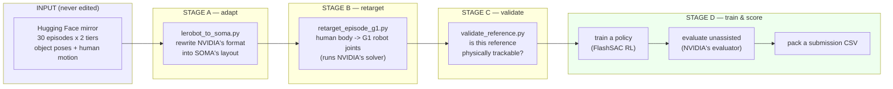
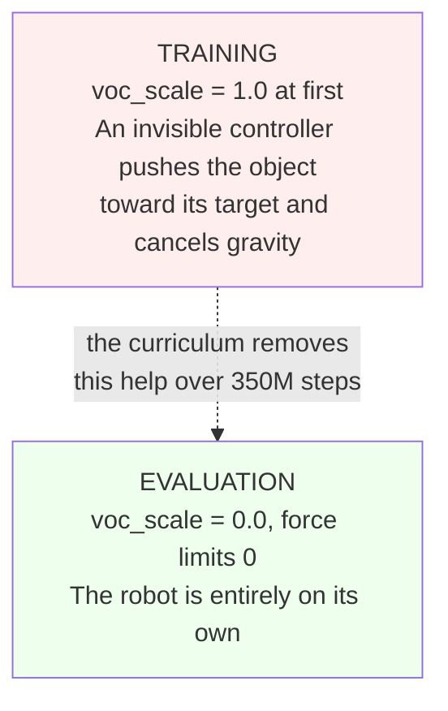
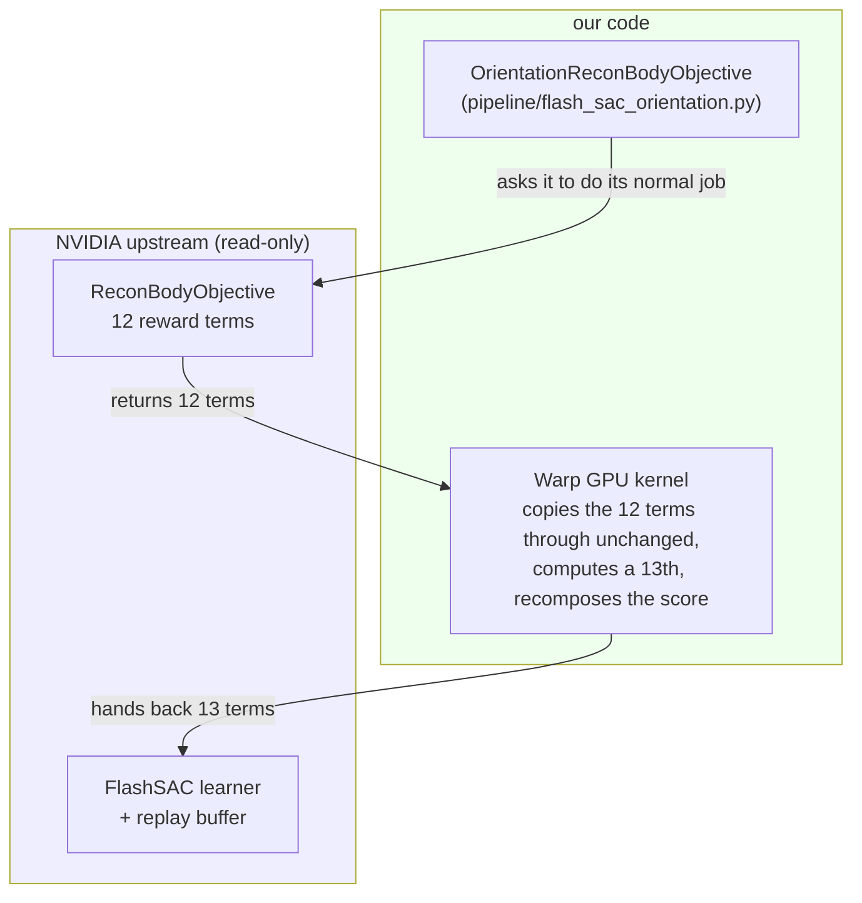
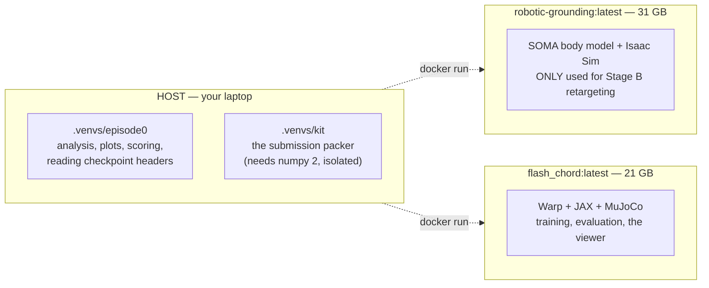
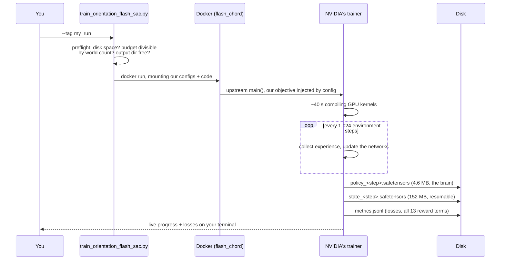
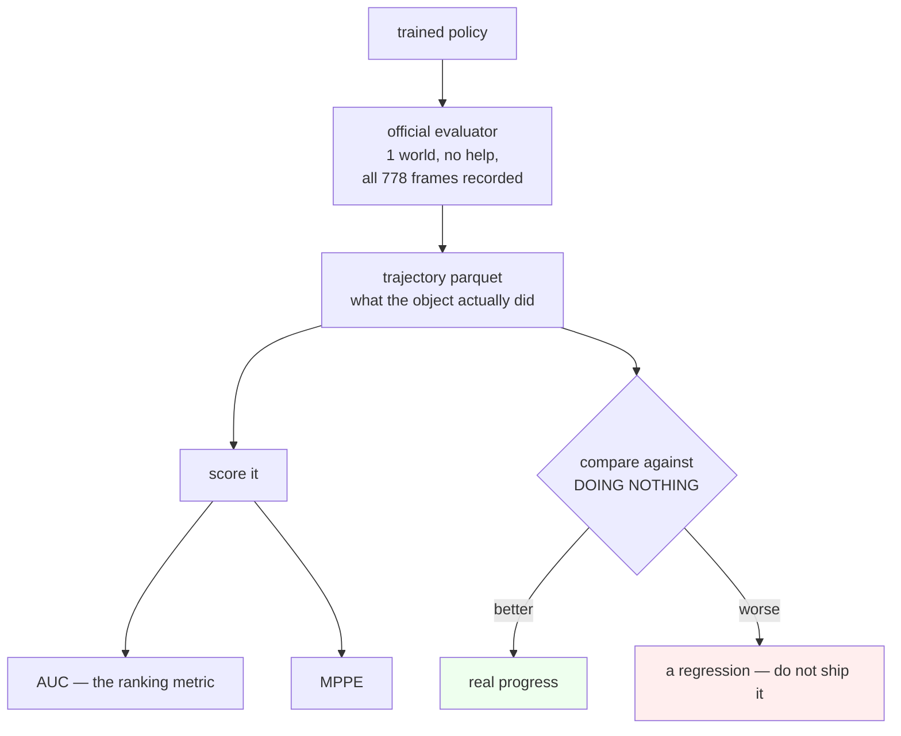

# How this project works

Plain-English explanation of what we built, why it is shaped this way, and how
data moves through it. If you only read one doc, read this one.

---

## 1. The problem, in one paragraph

NVIDIA filmed people doing everyday manipulation tasks — tipping up a bar stool,
sweeping with a squeegee, opening a rice cooker. They turned each video into a
**reference trajectory**: where the object was, frame by frame, and how the
person moved. Our job is to make a simulated Unitree G1 humanoid robot reproduce
**the object's motion**, with no help, and submit what the object actually did.
We are scored on how closely our object trajectory matches the real one.

The key thing to understand: **we are not scored on the robot.** We are scored
on the object. The robot is just the means.

## 2. The four stages

Everything we have built fits into four stages. Data flows left to right, and
each stage has its own validation gate so a problem is caught where it happens
rather than three stages later.

**Stage A — adapt.** The challenge ships data in NVIDIA's "LeRobot" format.
Their retargeting tool wants a different layout called SOMA. Stage A is a pure
format translation. It copies object poses through *byte for byte* — we never
reinterpolate or clean anything, because inventing a measurement would silently
corrupt everything downstream.

**Stage B — retarget.** A human has a different body from a G1 robot. This
stage solves, for every frame, the robot joint angles that best reproduce the
human pose. We do not write the solver — NVIDIA's `soma_to_g1.py` does it. We
only wrote a wrapper, because the original loads the whole sequence into GPU
memory at once and runs out of memory on 8 GB. Ours feeds it in chunks.

**Stage C — validate.** Before spending hours of GPU time, check the reference
is actually usable: are the joint velocities within the robot's real limits? Is
the solver's residual error comparable to NVIDIA's own demo? Did any frame blow
up? All 30 Tier 1 episodes pass.

**Stage D — train and score.** Reinforcement learning produces a policy; the
official evaluator runs it unassisted and records what the object did; the
packer turns that into a submission.

## 3. The one rule that matters most

During early training the simulator **helps**: a virtual controller (VOC) grabs
the object and pushes it toward where it should be. That is intentional — it
lets the robot learn the motion before it has to do the hard part. The
curriculum then withdraws that help in nine stages.

**Evaluation gives no help at all.** So a replay that looks perfect during
training can be worthless. This is the single easiest way to fool yourself on
this project, and we have a rule: *never present an assisted replay as policy
success.*

## 4. How we extend NVIDIA's code without touching it

`official/` is NVIDIA's code at a pinned commit. We never edit it — partly
because the organisers inspect our commit, and partly because an edit there is
invisible in our diffs and impossible to review.

So how did we add a 13th reward term? By **wrapping**, not patching:

The trick that makes this possible: everything downstream in FlashSAC sizes
itself from `len(objective.term_names)`. Nothing is hard-coded to 12. So a 13th
term flows into the replay buffer and the learning updates with **no upstream
change at all**.

Two things were subtle enough to be worth remembering:

- The reward must be stored **raw** (unweighted). FlashSAC re-derives the reward
  from stored raw terms every time it samples. If we had only changed the final
  scalar, the learner would have ignored it entirely.
- NVIDIA's evaluator rebuilds the whole experiment from config baked into the
  checkpoint file. A checkpoint trained with our objective names *our* Python
  module, which the evaluator cannot import. So we export a second copy of the
  policy whose config is rewritten back to the stock 12-term version, with
  identical weights. Same brain, different label on the box.

## 5. What actually runs where

Three execution environments, and mixing them up wastes a lot of time:

Rough guide: **if it touches the GPU physics, it is in a container.** If it
reads a file and prints numbers, it runs on the host.

## 6. Why the 8 GB laptop changed the design

NVIDIA's recipe asks for ~48 GB of GPU memory. We have 8. Almost every unusual
decision in this repo traces back to that:

| Their setting | Ours | Why |
|---|---|---|
| 2,048 parallel worlds | 1,024 | memory |
| 10,000,000-transition replay buffer | 500,000 | the buffer alone would be 21 GB |
| 4 learning updates per batch | 2 | matches the smaller world count |

That replay buffer cut is **20x**, and it is almost certainly why our fully
trained Episode 0 policy still scores below "do nothing". FlashSAC is an
off-policy algorithm; its replay buffer is not a detail, it is the algorithm.

**This is the single most important open question in the project**, and it is
why the cluster matters. See [TOP3_STRATEGY.md](../plans/TOP3_STRATEGY.md).

## 7. How a training run actually flows

The launcher exists because the raw Docker command is 30 lines and easy to get
wrong — and because a mistyped mount once silently produced a run with no code
in it.

## 8. How scoring works, and the trap in it

**The trap:** a frozen object is not a score of zero. On Episode 0 it scores
0.3769 AUC. Across the tier it scores 0.266 — which beats our actual submitted
entry on 26 of 30 episodes. So every result must be quoted against that floor,
not against zero and not against a previous bad policy.

**Why AUC is harsh:** it measures the fraction of frames where object points are
within 1–9 cm of the truth. On an object half a metre across, **ten degrees of
rotation already pushes you past 9 cm.** AUC is dominated by orientation — and
NVIDIA's stock reward has no object-orientation term at all. That mismatch is
the most defensible place to beat the baseline, and it is what our 13th term
exists for.

## 9. Where to go next

- **Want to run something?** [docs/guides/ONBOARDING.md](../guides/ONBOARDING.md)
- **Want to know what a file does?** [CODE_MAP.md](CODE_MAP.md)
- **Want the environment traps?** [CLAUDE.md](../../CLAUDE.md) — every line was
  learned by something breaking
- **Want the competitive plan?** [TOP3_STRATEGY.md](../plans/TOP3_STRATEGY.md)
